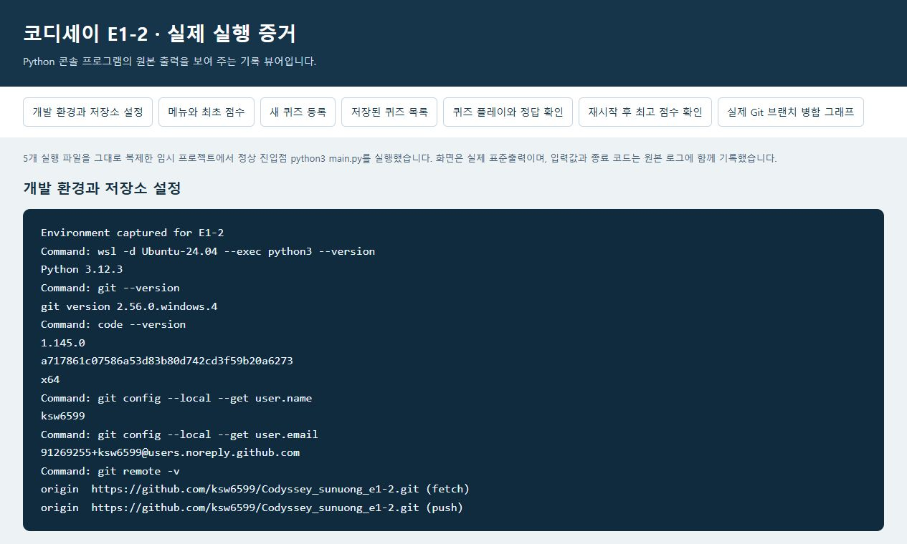
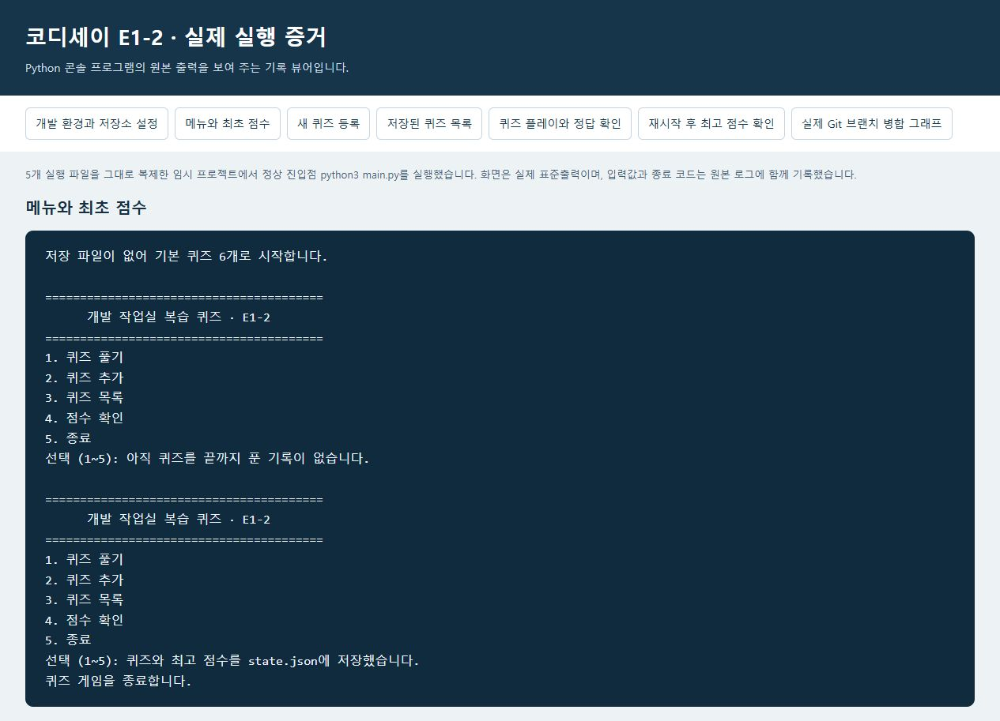
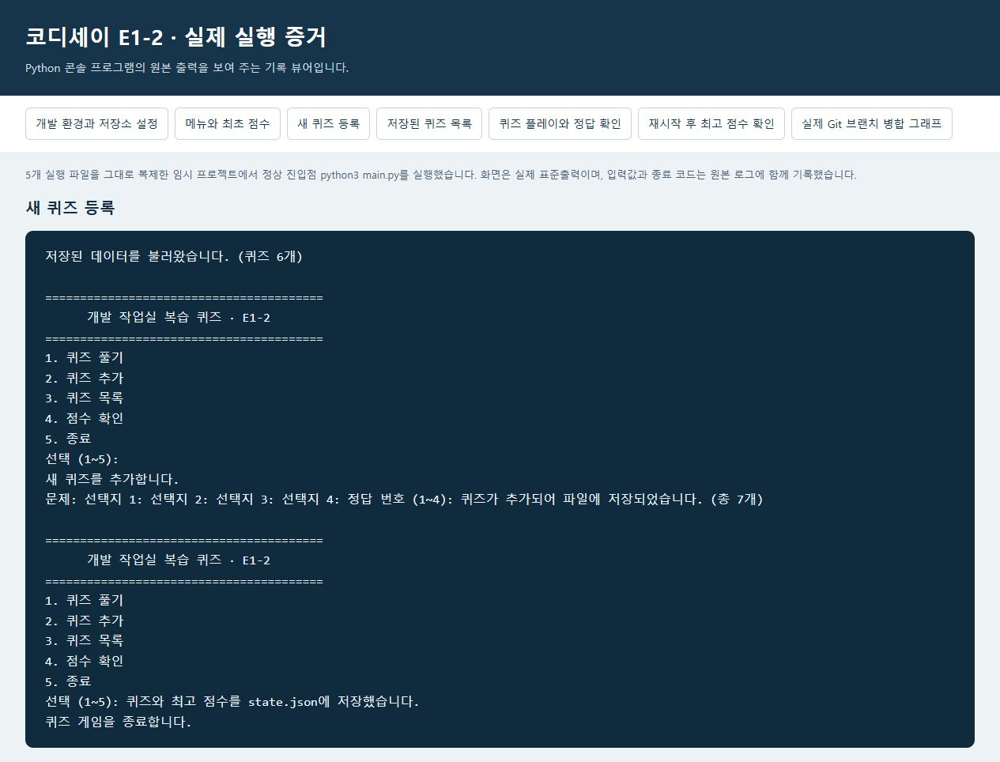
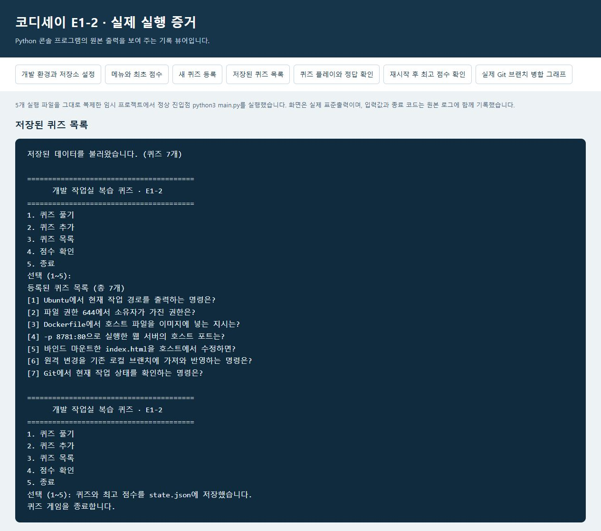
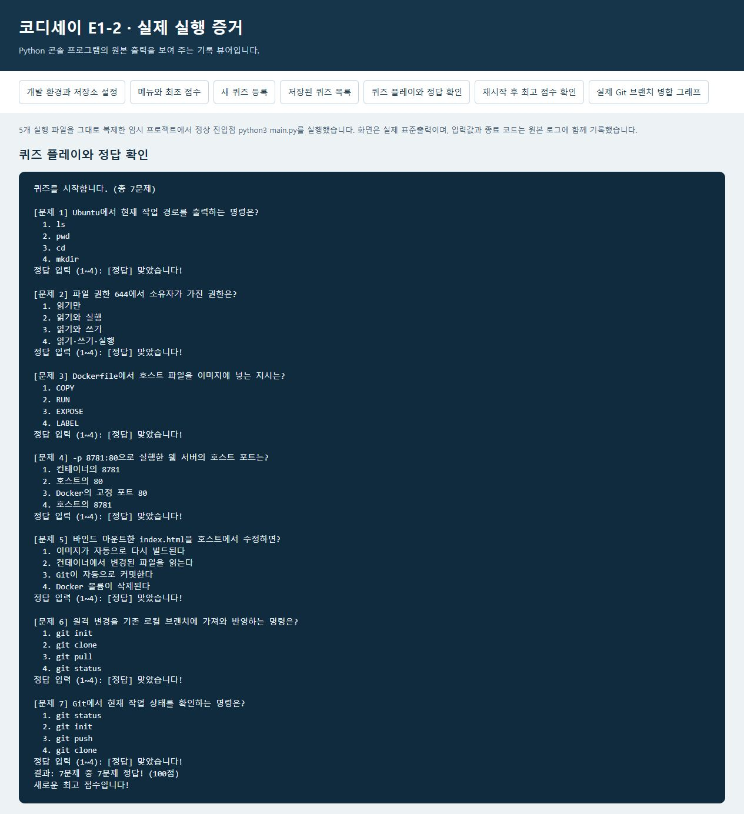
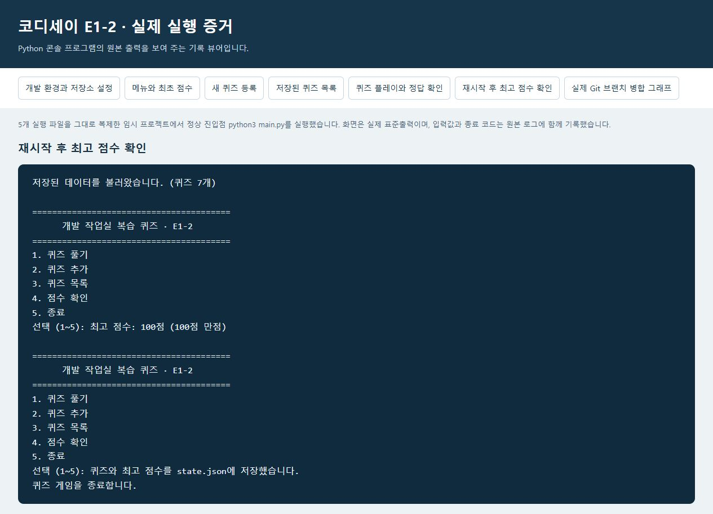
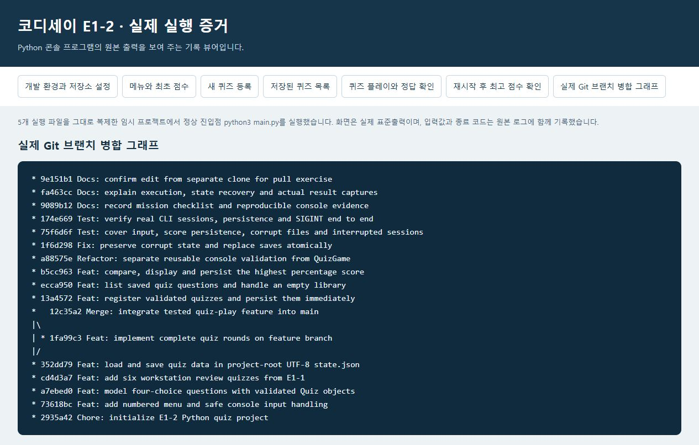

# 코디세이 E1-2 · 개발 작업실 복습 퀴즈

터미널에서 문제를 풀고 직접 추가하는 **Python 콘솔 퀴즈 게임**입니다. 추가한 문제와 최고 점수는 프로그램을 다시 실행해도 유지됩니다. Python 3.10 이상과 표준 라이브러리만 사용합니다.

## 주제와 선정 이유

E1-1에서 직접 사용한 **Ubuntu 터미널·파일 권한·Docker·Git**을 주제로 골랐습니다. `pwd`, `644`, `COPY`, `8781:80`, 바인드 마운트, `git pull`의 의미를 문제로 다시 설명하며 이전 과제와 Python 학습을 연결합니다. 기본 문제는 직접 작성한 6개이며 각각 선택지 4개와 정답 번호 1~4를 가집니다.

## 개발 환경

| 항목 | 실제 확인한 환경 |
|---|---|
| 호스트 / Python 실행 | Windows 11 / WSL Ubuntu 24.04 |
| Python | 3.12.3 (요구사항: 3.10 이상) |
| Git | Git for Windows 2.56.0.windows.4 |
| 편집기 | VS Code 1.145.0 |
| 외부 패키지 | 없음. pip 설치 불필요 |

[실제 버전·Git 설정 출력](docs/evidence/environment.txt) · [환경 캡처](docs/screenshots/environment.png)

## 실행 방법

이 PC에서는 Windows `python` 별칭 대신 설치된 Ubuntu Python을 사용합니다. PowerShell에서 아래 **명령만** 입력합니다. `PS C:\...>`는 터미널의 현재 위치 표시이므로 복사하지 않습니다.

```powershell
cd "C:\Users\04ksw\Documents\Codex\codyssey-e1-2"
wsl -d Ubuntu-24.04 --exec python3 /mnt/c/Users/04ksw/Documents/Codex/codyssey-e1-2/main.py
```

Ubuntu 터미널이나 Python이 설치된 다른 환경에서는 다음처럼 실행합니다. Windows에 Python 3.10 이상을 직접 설치한 환경은 `python main.py`도 가능합니다.

```bash
git clone https://github.com/ksw6599/Codyssey_sunuong_e1-2.git
cd Codyssey_sunuong_e1-2
python3 main.py
```

`C:\`는 Ubuntu에서 `/mnt/c/`입니다. 다른 폴더에서 `main.py`의 절대 경로로 실행해도 `state.json`은 프로젝트 루트에 생성됩니다.

```text
1. 퀴즈 풀기
2. 퀴즈 추가
3. 퀴즈 목록
4. 점수 확인
5. 종료
선택 (1~5):
```

## 기능 목록

- **풀기:** 전체 문제를 순서대로 출제하고 정답·오답과 최종 점수를 표시합니다. 빈 목록이면 메뉴로 돌아갑니다.
- **추가:** 문제, 선택지 4개, 정답 번호를 모두 받은 뒤 파일에 저장합니다. 도중에 중단된 미완성 문제는 추가하지 않습니다.
- **목록:** 저장된 모든 문제를 번호와 함께 표시합니다.
- **점수:** 이전 최고 점수와 비교·갱신·저장합니다. 미플레이(`null`)와 실제 0점(`0`)을 구분합니다.
- **입력 검증:** 앞뒤 공백을 제거하고 빈 입력, 문자, 허용 범위 밖 숫자는 안내 후 다시 입력받습니다. 메뉴와 정답에 공통 규칙을 적용합니다.
- **종료:** EOF와 Ctrl+C를 처리하고 가능한 데이터를 저장한 뒤 종료합니다.

점수는 `정답 수 * 100 // 전체 문제 수`입니다. 소수점 이하는 버리므로 6문제 중 5개 정답은 83점입니다. 문제 수가 바뀌어도 정답 비율로 비교하고, 이전 최고 점수보다 낮으면 기존 기록을 유지합니다. 미완료 게임은 새 점수로 기록하지 않습니다.

## 파일 구조

```text
main.py                     실행 진입점
game.py                     QuizGame: 메뉴·진행·점수·파일 저장/복구
quiz.py                     Quiz: 문제·선택지·정답 검증과 출력
defaults.py                 기본 복습 문제 6개
inputs.py                   숫자와 필수 문자열의 입력 검증
.gitignore                  개인 상태·캐시·로컬 미션 원문 제외
.gitattributes              소스·문서·로그 LF 줄바꿈 규칙
state.json                  실행 시 생성, Git 제외
tests/test_game.py          실패 경로를 포함한 단위 테스트 19개
scripts/verify.py           정상 진입점 12개 시나리오 재현
docs/requirements.md        최신 미션 필수 요구사항 요약
docs/evidence/              명령·입력·출력, Git 기록, 실제 저장 상태
docs/screenshots/           실제 실행 결과를 열어 캡처한 이미지
```

## state.json 설명

경로는 `game.py`와 같은 프로젝트 루트이고 UTF-8로 저장합니다. 최초 파일이 없으면 기본 문제 6개와 미플레이 상태로 시작합니다. 문제 추가, 게임 완료, 종료 때 저장합니다. 아래는 구조를 보여 주는 최소 예시입니다.

```json
{
  "quizzes": [
    {"question": "현재 경로를 출력하는 명령은?", "choices": ["ls", "pwd", "cd", "mkdir"], "answer": 2}
  ],
  "best_score": null
}
```

`quizzes`는 퀴즈 객체 목록, `best_score`는 `null` 또는 0~100 정수입니다. `true`/`false`를 정답이나 점수 정수로 받아들이지 않습니다.

- 손상된 JSON·UTF-8·데이터 구조는 안내 후 기본 데이터로 복구합니다. 원본은 `state.json.broken-<시간값>.bak`으로 보존합니다.
- 원본을 읽거나 백업하지 못하면 기존 파일을 보호하기 위해 그 실행은 메모리에서만 작동하고 저장 중지 메시지를 냅니다.
- 같은 폴더의 임시 파일에 먼저 쓴 뒤 `state.json`으로 교체합니다. 교체 실패 시 기존 파일을 유지하고 실패를 표시합니다.
- 동시 실행 간 상태 병합은 구현하지 않았습니다. 한 번에 한 프로그램으로 사용합니다.

[실제 데모 저장 상태](docs/evidence/state-after-demo.json)는 7번째 문제를 추가하고 100점을 받은 증거입니다. 개인 실행 상태는 Git에서 제외하므로 새로 clone하면 기본 6문제로 시작합니다.

## 검증과 실행 증거

프로젝트 폴더의 Ubuntu 터미널에서 실행합니다. 별도 임시 프로젝트를 사용하므로 본인의 `state.json`을 변경하지 않습니다.

```bash
python3 -m unittest discover -s tests -v
python3 scripts/verify.py
```

```text
Ran 19 tests
OK
ALL CHECKS PASSED (12 entrypoint scenarios + 19 unit tests)
```

실제 `main.py`로 오류 입력, 등록, 7문제 100점, 낮은 점수 뒤 최고 기록 유지, 재시작, 빈 목록, 손상 JSON 백업, EOF, 실제 SIGINT, 실제 파일 읽기 오류를 확인했습니다. 단위 테스트는 실제 쓰기 오류와 **모의** 교체/백업 거부도 별도로 검사합니다.

[전체 검증 로그](docs/evidence/verification.log) · [메뉴](docs/evidence/menu.txt) · [등록](docs/evidence/add_quiz.txt) · [목록](docs/evidence/list.txt) · [플레이](docs/evidence/play.txt) · [재시작 점수](docs/evidence/score.txt)

아래 캡처는 실행 파일 5개를 그대로 복사한 임시 프로젝트에서 `python3 main.py`로 얻은 **실제 표준출력을 기록 뷰어로 열어 저장한 화면**입니다. 파이프 입력은 자동으로 반향되지 않으므로 원본 로그에 실제 입력값과 종료 코드를 함께 기록했습니다.

| 환경 | 메뉴 | 등록 |
|---|---|---|
|  |  |  |

| 목록 | 플레이 | 점수 |
|---|---|---|
|  |  |  |

## Git 이력과 브랜치

새 공개 저장소에서 첫 커밋 `2935a42`를 먼저 push했습니다. 메뉴, Quiz, 기본 데이터, JSON, 플레이, 등록, 목록, 점수, 입력 분리, 복구, 테스트, 문서의 실제 변경을 기능별로 커밋했습니다. `feature/quiz-play`에서 플레이를 구현·push한 뒤 `main`에 `--no-ff` 병합했습니다.

```powershell
git init -b main
git add .gitignore .gitattributes README.md
git commit -m "Chore: initialize E1-2 Python quiz project"
git push -u origin main
git checkout -b feature/quiz-play
git checkout main
git merge --no-ff feature/quiz-play
git log --oneline --graph --all
```

위는 실제 수행 흐름의 핵심 명령입니다. 기능마다 변경 파일을 add하고 변경 내용을 요약해 commit했습니다. 초기화는 처음 한 번만 실행합니다. [실제 Git 명령과 출력](docs/evidence/git-workflow.log) · [그래프 원본](docs/evidence/git-graph.txt)



## clone / pull 실습

별도 디렉터리에 clone → 복제본 README 수정·commit·push → 기존 작업 폴더에서 `pull --ff-only` → 변경 반영 확인을 수행하고 결과를 아래에 기록합니다.

## 트러블슈팅

1. **Windows python이 실행되지 않음:** Store 별칭 대신 위의 WSL Python 명령을 사용합니다.
2. **다른 폴더에서 실행 후 저장 파일을 찾지 못함:** 현재 폴더가 아니라 `game.py` 위치의 `state.json`을 확인합니다.
3. **손상 안내:** `.bak`을 보관하고 선택지 4개, 정답 1~4 정수, 최고 점수 구조를 확인합니다.
4. **저장 중지/실패:** 폴더 쓰기 권한과 `state.json`이 실제 파일인지 확인합니다. 그 실행의 변경은 메모리에만 있을 수 있습니다.

## 제출 점검

- [x] Python 3.10 이상, 외부 패키지 없음
- [x] Quiz / QuizGame과 기능별 메서드, 메뉴 5개
- [x] 주제 있는 기본 문제 6개와 입력 검증
- [x] EOF·Ctrl+C·빈 목록·데이터 복구·입출력 실패 처리
- [x] 재시작 후 추가 문제와 최고 점수 유지
- [x] 의미 있는 커밋 10개 이상, 기능 브랜치와 실제 merge
- [ ] 별도 clone에서 수정·push 후 기존 폴더 pull 결과 확인
- [x] 개요·주제·실행·기능·구조·데이터 파일 문서
- [x] 실제 환경 및 프로그램 실행 결과 캡처
- [ ] 최종 Git 그래프 캡처와 증거 링크 점검

선택 기능(랜덤·문제 수 선택·힌트·삭제·히스토리)은 이번 구현 범위에 넣지 않았습니다.
